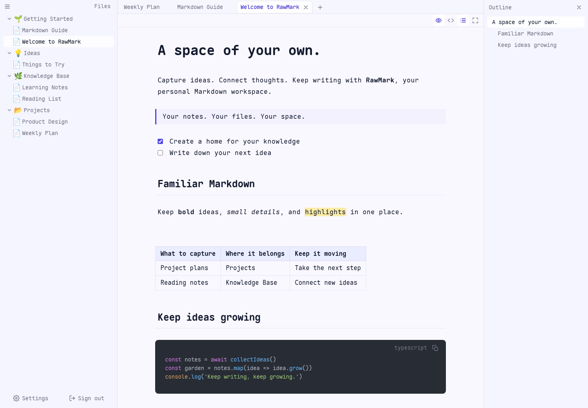

<div align="center">
  
  <h1>RawMark</h1>
  <p><strong>A space of your own. A place to write.</strong></p>
  <p>A self-hosted Markdown workspace for your personal notes. Your files, your server, ready in your browser.</p>
  <p><strong>English</strong> · <a href="README.zh-CN.md">简体中文</a></p>
  <p>
    <a href="https://eezd.github.io/RawMark/">Try the editor</a> ·
    <a href="#quick-start">Quick start</a> ·
    <a href="docs/guide.md">User guide</a> ·
    <a href="docs/deployment.md">Deployment</a> ·
    <a href="https://github.com/eezd/RawMark/issues">Report an issue</a>
  </p>
</div>

<picture>
  <source media="(prefers-color-scheme: dark)" srcset="docs/images/workspace-dark.png" />
  
</picture>

<p align="center"><sub>Actual workspace with sample notes · <a href="docs/images/workspace-light.png">Light mode</a> · <a href="docs/images/workspace-dark.png">Dark mode</a></sub></p>

## Made for your notes

RawMark is for people who want to keep their notes on their own server. Organize knowledge, track projects, and collect ideas, then pick up where you left off in a browser on your computer, tablet, or phone.

Notes are ordinary `.md` files, with images stored in an `assets/` folder alongside them. Access your files directly or export them whenever you like, and open them with the Markdown tools you already use.

- **Focus on writing.** Switch between Markdown live preview and source mode, with support for tables, task lists, math, Mermaid diagrams, and syntax highlighting.
- **Keep things organized.** Folders, tags, full-text search, and document outlines, with drag-and-drop moves, bulk actions, and custom file icons.
- **Continue where you left off.** Multiple tabs and pinned notes survive refreshes and browser restarts. Changes save automatically, and external file edits sync to the page.
- **Keep images with your notes.** Paste, upload, or import images in bulk. View references, rename, move, replace, and clean up unreferenced images in the image manager.
- **Make it feel familiar.** English and Simplified Chinese, light and dark modes, separate interface, text, and code fonts, font imports, customizable shortcuts, themes, and CSS snippets.
- **Take your data with you.** Import Markdown or ZIP archives and export notes with attachments. Use the recycle bin, full-instance backups, settings migration, API automation, and frontend plugins.

RawMark is built for **single-user, self-hosted use**. It currently does not offer collaboration or public sharing.

## Quick start

With Docker installed:

```sh
docker run -d --name rawmark --restart unless-stopped \
  -p 127.0.0.1:21000:8080 \
  -v rawmark-data:/data \
  ghcr.io/eezd/rawmark:0.1.0
```

Open **http://localhost:21000** and set your password on first use. A new, empty instance starts with seven English example notes; edit or delete them and begin writing. Data lives in the Docker volume `rawmark-data` and persists when you recreate the container with the same volume.

Linux amd64 and arm64 are supported. Prefer a native program? Download it from [Releases](https://github.com/eezd/RawMark/releases), or build from source using the deployment guide.

[Try the online editor](https://eezd.github.io/RawMark/) without installing anything. Demo edits are temporary and reset on refresh; the demo does not provide a server-backed workspace.

These commands listen on localhost only. For a remote server, complete the initial setup before configuring HTTPS access. See the [deployment guide](docs/deployment.md) for Docker Compose, existing note folders, backups, and upgrades.

## Documentation

All guides are available in English and Simplified Chinese. Use the language link at the top of each guide to switch.

| What you want to do | Start here |
| --- | --- |
| Write, organize notes, manage images, and customize the workspace | [User guide](docs/guide.md) |
| Deploy, configure storage, back up, and upgrade | [Deployment and maintenance](docs/deployment.md) |
| Develop locally, understand the project structure, and run checks | [Development guide](docs/development.md) |
| Write scripts, authenticate, and call the API | [API and authentication](docs/api.md) |

## Help and contributing

Bug reports and suggestions are welcome in [Issues](https://github.com/eezd/RawMark/issues). Include your version, deployment method, browser, and steps to reproduce. Remove passwords, tokens, and private note content from logs and screenshots.

Before contributing, read [AGENTS.md](AGENTS.md) (in Simplified Chinese) and the [development guide](docs/development.md). RawMark prioritizes simplicity and clarity; please discuss substantial features or architectural changes in an issue first.

## Acknowledgments and license

Built with projects including [CodeMirror](https://codemirror.net/), [Vue](https://vuejs.org/), [Element Plus](https://element-plus.org/), [highlight.js](https://highlightjs.org/), and [Maple Mono](https://github.com/subframe7536/maple-font). The frontend structure draws on [vue3-starter](https://github.com/eezd/vue3-starter), whose [MIT license](web/LICENSE) is retained. [Maple Mono](web/src/common/appearance/fonts/maple/LICENSE.txt) and other third-party assets retain their respective licenses.

RawMark is open source under the [MIT License](LICENSE). Third-party code and fonts retain their own license and copyright notices.
